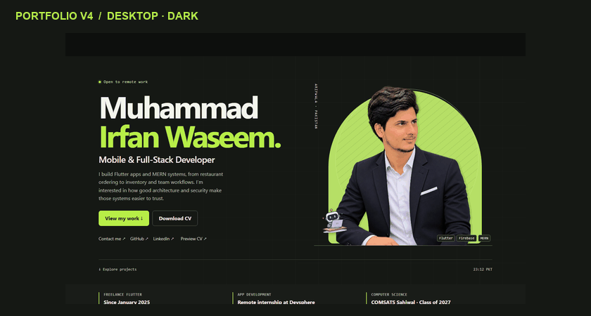

<h1 align="center">Muhammad Irfan Waseem</h1>
<p align="center"><strong>Mobile &amp; Full-Stack Developer</strong><br>Flutter, Firebase and MERN · Arifwala, Pakistan · Open to remote work</p>

<p align="center">
  <a href="https://ir786106.github.io/Muhammad_Irfan_Waseem_Portfolio/">Live portfolio</a> ·
  <a href="https://github.com/Ir786106/Muhammad_Irfan_Waseem_Portfolio/releases/tag/v4.0.0">V4.0.0 release</a> ·
  <a href="https://ir786106.github.io/Muhammad_Irfan_Waseem_Portfolio/assets/Irfan_Resume.pdf">Résumé</a> ·
  <a href="https://www.linkedin.com/in/muhammad-irfan-waseem-48226b297/">LinkedIn</a>
</p>

<p align="center">
  
</p>

## About the portfolio

I build Flutter apps and full-stack systems for workflows such as restaurant ordering, inventory and team collaboration. This portfolio collects my projects, technical decisions and release artifacts. I’m a Computer Science student at COMSATS University Islamabad, Sahiwal Campus, with expected graduation in 2027.

## Selected work

| Project | What it covers |
| --- | --- |
| [Food Fight](https://ir786106.github.io/Muhammad_Irfan_Waseem_Portfolio/#work/food-fight) | Flutter ordering and delivery workflows backed by Firebase. The public release includes Android and Windows builds. |
| [MillX ERP](https://ir786106.github.io/Muhammad_Irfan_Waseem_Portfolio/#work/ittehad-food-industries) | Academic rice-industry ERP and supply chain project covering procurement, processing, inventory and distribution. |
| [Mandi Pro ERP](https://ir786106.github.io/Muhammad_Irfan_Waseem_Portfolio/#work/mandi-pro-erp) | Flutter and Firebase workflows for grain inventory, purchasing, sales and ledgers. |
| [TeamSync SaaS](https://ir786106.github.io/Muhammad_Irfan_Waseem_Portfolio/#work/teamsync) | MERN and TypeScript prototype for role-aware workspaces, projects and tasks. |

Browse the [project archive](https://ir786106.github.io/Muhammad_Irfan_Waseem_Portfolio/#work), [architecture explorer](https://ir786106.github.io/Muhammad_Irfan_Waseem_Portfolio/#architecture) or [application downloads](https://ir786106.github.io/Muhammad_Irfan_Waseem_Portfolio/#downloads). Press Ctrl+K or Cmd+K on the homepage for quick navigation.

## Run locally

### V4 homepage

Serve the static site with Python 3 from the repository root. Open [localhost on port 8176](http://127.0.0.1:8176/).

```sh
python -m http.server 8176 --directory site
```

### Astro routes

Use Node.js 22.12 or later for the dedicated About, project and résumé pages.

```sh
npm ci
npm run dev
```

Run checks and create a local production build.

```sh
npm run check
npm run lint
npm test
npm run build
npm run preview
```

For browser tests, install Chromium with `npx playwright install chromium` and run `npm run test:e2e`. A production Pages build uses `SITE_URL=https://ir786106.github.io` and `BASE_PATH=/Muhammad_Irfan_Waseem_Portfolio/`.

## Repository layout

| Path | Purpose |
| --- | --- |
| `site/` | Standalone V4 homepage, styles, JavaScript, assets and project records. |
| `site/data/projects.json` | Project content. Sync the bundled fallback in `site/js/data.js` after edits. |
| `src/pages/` and `src/data/` | Astro routes and their content. |
| `public/images/` | Media used by Astro routes. |
| `docs/` | Project evidence, deployment notes and README media. |
| `.github/workflows/pages.yml` | GitHub Pages build, validation and deployment. |

## Deployment and release

Pushes to `main` trigger the [GitHub Pages workflow](https://github.com/Ir786106/Muhammad_Irfan_Waseem_Portfolio/actions/workflows/pages.yml). It builds and validates the Astro routes, overlays the V4 homepage from `site/`, then deploys the combined output. The [V4 static ZIP](https://github.com/Ir786106/Muhammad_Irfan_Waseem_Portfolio/releases/download/v4.0.0/portfolio-site.zip) is available for local preview or standalone hosting.

## Contact

For mobile, full-stack or ERP work, get in touch by [email](mailto:muhammadirfan.infosec@gmail.com) or use the [portfolio contact form](https://ir786106.github.io/Muhammad_Irfan_Waseem_Portfolio/#contact).
